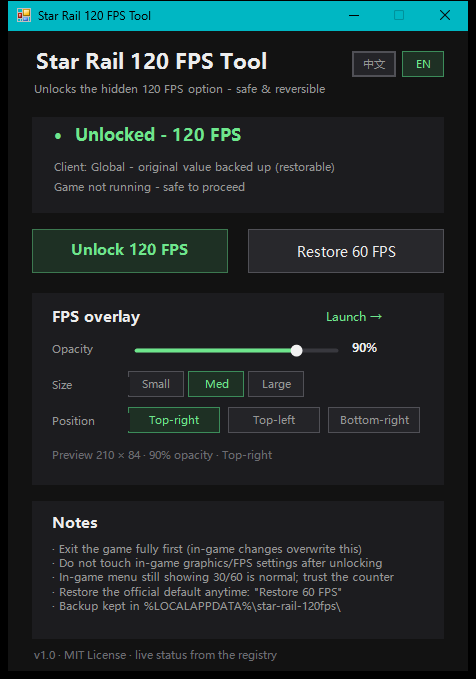
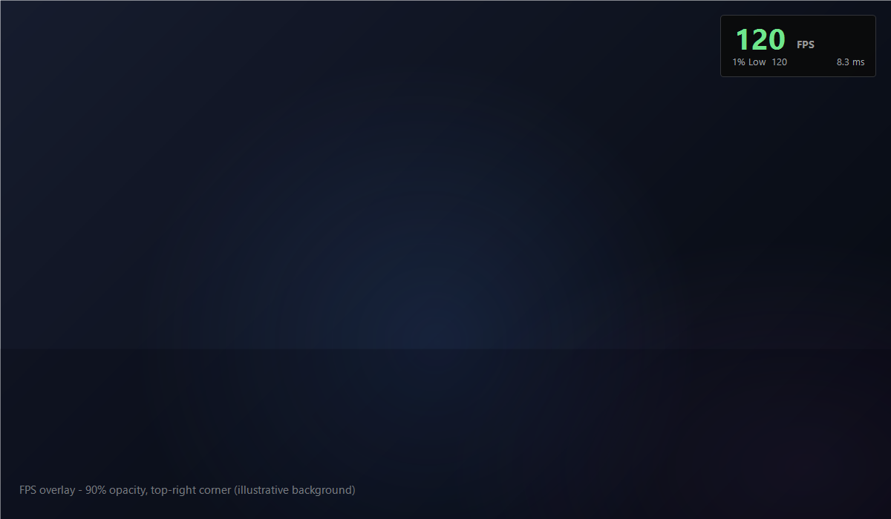

# Star Rail 120 FPS Unlock (one-click scripts)

[中文](README.md) | **English**

Honkai: Star Rail on PC hides its 120 FPS option: the in-game menu only offers 30/60, while the game itself supports 120. This tool edits the game's own settings value (the same hidden option) — one click, no background software.

- Pure PowerShell: no injection, no game file modifications, no anti-cheat interaction
- Built-in GUI (switch between 中文 / English), live status, one-click unlock / restore
- Works with the global client and the China client (auto-detected)
- Automatic backup + one-click restore to the official default (60)
- Ships with a GPU-agnostic FPS counter window (NVIDIA / AMD / integrated graphics)

> Requirements: Windows 10 / 11 with the built-in PowerShell 5.1. Nothing to install.

## Quick start

1. Download this repository (`Code → Download ZIP`, or `git clone`)
2. **Fully close the game first**
3. Double-click `StarRail-120FPS.bat` to open the GUI
4. Click "Unlock 120 FPS" — the status turns to "Unlocked - 120 FPS"
5. Launch the game

To go back to the official 60 FPS cap: close the game and click "Restore 60 FPS (default)" in the GUI.

> Prefer the command line? `SET-120FPS.bat` (unlock) and `RESTORE-60FPS.bat` (restore) still work.

## GUI (recommended)



- Launch with `StarRail-120FPS.bat`; switch between 中文 / English at the top right, or start directly in English with `powershell -File scripts\fps-gui.ps1 -Lang en`
- Live status read from the registry: current FPS cap, detected client (global / China), and a note that the original value is backed up
- Warns "game is running — fully exit it first" so your change is not overwritten
- Bottom button launches the FPS overlay; usage notes are always visible

## Verify the frame rate

Note: after unlocking, the in-game Settings → FPS value may still display 30/60 — that is a known display bug caused by the hidden option. Trust an external counter instead:

| Method | GPU | How |
|---|---|---|
| FPS counter window (included) | All (NVIDIA / AMD / integrated) | Double-click `FPS-MONITOR.bat`, approve one UAC prompt |
| Xbox Game Bar | All, built-in | `Win+G` → Performance widget → pin it |
| NVIDIA app | NVIDIA only | Press `Alt+R` in game (`Alt+Z → Statistics → Configure heads-up display` to slim it down) |

Expect a steady frame rate close to 120; small dips in heavy scenes are normal.

## The FPS counter (FPS-MONITOR.bat)



- Powered by Intel's official open-source [PresentMon](https://github.com/GameTechDev/PresentMon) (MIT), reading system-level frame events (ETW) — **works on any GPU**, never injects into the game
- Asks for administrator rights once: a Windows requirement for reading frame events; it only reads, never modifies anything
- About 210×84 px, docked to the **top-right corner**; rounded dark panel at 90% opacity showing **FPS + 1% low + frame time (ms)**; draggable, right-click → Exit
- Color coding: green ≥60 / yellow 30–59 / red <30; the window closes itself when the target process exits
- Best on a second monitor, or with the game running in borderless-windowed mode (Windows does not allow other windows over exclusive fullscreen)
- Bundled PresentMon: v2.6.0 (x64), SHA-256 `b2a706bc6ad475749e3b7e3409263aa1e6906d45bdcf993f6dbc0f660188f1af`

### Make it permanently UAC-free (optional)

PresentMon officially supports a non-elevated path: add your user to the `Performance Log Users` system group. Run once as administrator:

```bat
net localgroup "Performance Log Users" %USERNAME% /add
```

Takes effect **after you sign out and back in**; `FPS-MONITOR.bat` will no longer prompt for elevation. To undo, run the same command with `/delete`.

## FAQ

- The game still shows 30/60 in settings. → Known display bug, see above; trust the external counter.
- Frame rate dropped back after I changed graphics options. → Any in-game graphics change resets the cap to 60; unlock again.
- How do I change the GUI language? → Click 中文 / EN at the top right, or start with `-Lang en`.
- Does it need admin rights? → The unlock script does not (it only edits your own user registry setting). The FPS counter needs one elevation prompt (to read system frame events).
- Is it bannable? → It does not inject, does not modify game files, and only edits a local display setting (same class as changing an in-game option). Use at your own risk and respect the game's terms.
- Which clients are supported? → Global `HKCU\Software\Cognosphere\Star Rail`; China `HKCU\Software\miHoYo\崩坏：星穹铁道`. Both clients officially expose only 30/60.
- My monitor isn't 120 Hz. → Still fine. The script warns you that gains are limited below 120 Hz (but it can still reduce stutter).

## How it works

The game stores its graphics settings in the current user's registry, under a binary value named `GraphicsSettings_Model_h*` (UTF-8 JSON). `"FPS":60` is the visible option. The script:

1. Backs up the original value as Base64 to `%LOCALAPPDATA%\star-rail-120fps\backup.b64` (first run only)
2. Replaces the `"FPS"` number with the target (120 or 60) and writes it back
3. Reads it back and verifies

## Safety & rollback

- Edits only your own user registry setting — equivalent to changing an in-game option. No system files, no services, nothing running in the background
- The original value is backed up automatically; "Restore 60 FPS" (or `RESTORE-60FPS.bat`) returns to the official default
- Not affiliated with the game's developer or publisher. Use at your own risk.

## Related projects

- [PresentMon](https://github.com/GameTechDev/PresentMon) (Intel, MIT) — data source for the FPS counter
- Similar FPS-cap unlockers (for reference/comparison): [winTEuser/Genshin_StarRail_fps_unlocker](https://github.com/winTEuser/Genshin_StarRail_fps_unlocker)

## License

[MIT](LICENSE)
