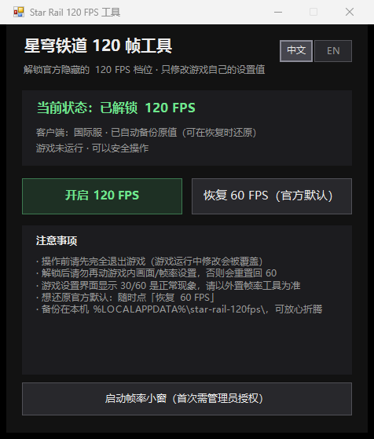

# 星穹铁道 120 帧解锁（一键脚本）· Star Rail 120 FPS Unlock

**中文** | [English](README.en.md)

崩坏：星穹铁道 PC 版官方把 120 FPS 选项藏了起来——游戏内菜单只有 30/60 两档，但游戏本身支持 120 帧。本工具只修改游戏自己的一个设置值（等同官方隐藏档位），一键解锁，不需要任何程序常驻。

- 纯 PowerShell 脚本：无注入、不改游戏文件、不碰反作弊
- 自带图形界面（中文 / English 随时切换），显示当前状态，一键开启 / 恢复
- 支持国际服与国服客户端（自动识别）
- 自动备份原值，一键恢复官方默认（60）
- 附送跨显卡的帧率验证小窗（NVIDIA / AMD / 核显都可用）

> 适用：Windows 10 / 11，系统自带 PowerShell 5.1 即可，无需安装任何东西。

## 快速开始

1. 下载本仓库（`Code → Download ZIP`，或 `git clone`）
2. **先完全退出游戏**
3. 双击 `StarRail-120FPS.bat`，打开图形界面
4. 点「开启 120 FPS」，状态变成「已解锁 120 FPS」即成功
5. 重新进游戏

想恢复官方默认 60 帧：退出游戏后，在界面里点「恢复 60 FPS（官方默认）」。

> 习惯命令行？也可以直接双击 `SET-120FPS.bat`（解锁）/ `RESTORE-60FPS.bat`（恢复）。

## 图形界面（推荐入口）



- 双击 `StarRail-120FPS.bat` 启动；右上角可在**中文 / English** 间随时切换（也可用 `powershell -File scripts\fps-gui.ps1 -Lang en` 直接以英文启动）
- 状态区实时读取注册表：当前帧率档位、检测到的客户端（国际服 / 国服）、原值已备份提示
- 游戏运行中会提示「请先完全退出游戏」，避免改动被游戏覆盖
- 底部入口一键启动帧率小窗；注意事项常驻显示

## 验证帧率生效（任选一种）

注意：解锁后游戏内"设置 → 帧率"可能仍显示 30/60——这是官方隐藏档位造成的**显示不同步**，以外部计数器实测为准。

| 方法 | 适用显卡 | 操作 |
|---|---|---|
| 帧率小窗（本仓库附带） | 全部（N 卡 / A 卡 / 核显） | 双击 `FPS-MONITOR.bat`，授权一次后屏幕出现实时帧率 |
| Xbox Game Bar | 全部，免安装 | `Win+G` → 性能 面板 → 点"钉住" |
| NVIDIA app | 仅 NVIDIA | 游戏内按 `Alt+R` 显示性能层（`Alt+Z → 统计 → 配置 HUD` 可精简） |

预期：帧率稳定接近 120，复杂场景小幅波动属正常。

## 帧率小窗（FPS-MONITOR.bat）说明

- 原理：调用 Intel 官方开源工具 [PresentMon](https://github.com/GameTechDev/PresentMon)（MIT）读取 Windows 图形栈的帧事件（系统级 ETW），**与显卡品牌无关**，不注入游戏进程
- 会请求一次管理员权限：这是 Windows 读取帧事件的系统要求，仅用于读数，不修改任何东西
- 尺寸约 210×84 像素，默认停在屏幕**右上角**；深色圆角面板（80% 不透明度），显示 **FPS + 1% Low + 帧时间(ms)**，可拖动；右键 → Exit 退出
- 读数配色：绿色 ≥60 / 黄色 30–59 / 红色 <30；目标进程退出后小窗自动关闭
- 建议放在屏幕角落，或副屏；游戏切到「无边框窗口」模式时可叠加显示（独占全屏模式下 Windows 不允许其他窗口覆盖）
- 内置 PresentMon 版本：v2.6.0 (x64)，SHA-256 `b2a706bc6ad475749e3b7e3409263aa1e6906d45bdcf993f6dbc0f660188f1af`

### 想让小窗永久免管理员授权（可选）

PresentMon 官方支持一条免提权的路径：把当前用户加入系统组 `Performance Log Users`（性能日志用户）。操作（需一次管理员权限）：

```bat
net localgroup "Performance Log Users" %USERNAME% /add
```

**重新登录 Windows 后**生效；此后 `FPS-MONITOR.bat` 不再弹授权框。不需要该优化时，把上面的 `/add` 换成 `/delete` 即可移除。

## 常见问题

- 为什么游戏设置里还是显示 30/60？→ 已知显示 bug，见上文；设置菜单里的数字不可信。
- 改过画质设置后帧率掉了？→ 游戏内动任何画面设置会把帧率重置回 60，重新跑一次解锁即可。
- 怎么切换界面语言？→ 界面右上角点「中文 / EN」即时切换，或 `-Lang en` 参数直接启动英文界面。
- 需要管理员权限吗？→ 解锁脚本不需要（只改当前用户自己的注册表设置）；帧率小窗需要一次授权（读系统帧事件）。
- 有封号风险吗？→ 本工具不注入、不改游戏文件，只改本机显示设置值（与你手动在游戏里改选项同类）。请自行评估并遵守游戏条款。
- 支持哪些客户端？→ 国际服 `HKCU\Software\Cognosphere\Star Rail`；国服 `HKCU\Software\miHoYo\崩坏：星穹铁道`。两个客户端官方都只给 30/60 两档。
- 显示器不是 120Hz 能用吗？→ 能。脚本会检测并提示：屏幕刷新率低于 120Hz 时，120 FPS 上限的收益有限（但仍可减少卡顿）。

## 工作原理

游戏的图形设置存放在注册表（当前用户）下、名为 `GraphicsSettings_Model_h*` 的二进制值（UTF-8 JSON）中，其中 `"FPS":60` 对应可见档位。脚本做三件事：

1. 把原始值 Base64 备份到 `%LOCALAPPDATA%\star-rail-120fps\backup.b64`（仅首次）
2. 将 `"FPS"` 数字替换为目标值（120 或 60）后写回
3. 读回校验并报告结果

## 安全与回滚

- 仅修改当前用户的注册表设置值，等效于游戏内改设置；不写系统目录、不装服务、不常驻
- 原始值自动备份；随时点「恢复 60 FPS」或跑 `RESTORE-60FPS.bat` 恢复默认
- 与本游戏开发 / 发行方无任何关联；使用风险自负

## 相关项目

- [PresentMon](https://github.com/GameTechDev/PresentMon)（Intel，MIT）——帧率小窗的数据来源
- 同类帧率解锁工具（可对比参考）：[winTEuser/Genshin_StarRail_fps_unlocker](https://github.com/winTEuser/Genshin_StarRail_fps_unlocker)

## License

[MIT](LICENSE)
